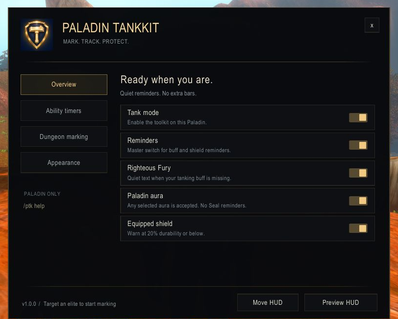

# Paladin TankKit — WoW Forever

**Mark. Track. Protect.** A compact Paladin tank companion for Forever Interface **16001**. Current build: **1.0.6**.

## Install

Download this repository, then copy its inner `PaladinTankKit` folder into the game's `Interface/AddOns` folder. The resulting path should be `Interface/AddOns/PaladinTankKit/PaladinTankKit.toc`. Restart WoW after adding the addon. Developers can run `npm ci` and `npm run package` to build `dist/PaladinTankKit-1.0.6.zip`. Generated archives and local installation backups are excluded from this repository.

[View the in-game Preview animation](release/media/gallery/06-in-game-preview-under-2MB.gif). The sample timers are visibly labeled Preview; this is not dungeon combat footage.

The AddOns list now uses the project's original gold shield-and-hammer emblem, supplied as a game texture in `Media/AddonIcon.tga`. The matching CurseForge upload is `Branding/PaladinTankKit-CurseForge-400.png`; the master and small-size previews are alongside it. `scripts/export-branding.ps1` regenerates the PNG exports and game texture from the master. Spell timers retain their actual ability artwork.

Type `/ptk` for the redesigned settings: Overview, Ability timers, Protection, Dungeon marking and Appearance. Each tracked ability and each reminder has its own switch. Unlock the anchor to move it, then lock it. Bind the secure **Skull** and **X** actions in WoW's Key Bindings under Paladin TankKit, or use the native Raid Targeting bindings. Existing bindings are never changed. Settings are saved per character; other classes do not run the toolkit.

## Timers and motion

Middle-click an ability timer, protection badge or cleanse reminder to hide it. Restore individual items in `/ptk` > **Ability timers** or **Protection**, click **Restore all**, or type `/ptk restore`. Preferences are saved per character; enabling a timer does not display inactive effects.

The combat tracking flow uses separate player-aura and cast/cooldown trackers. Each ability owns an independent deadline. Changing targets, Judgement, Seal procs and updates to another ability cannot restart it.

- **Seals:** one selected Seal at a time. Real player buff expiration wins. A confirmed requested cast starts a fallback countdown using that Seal's previously observed duration, or a 30-second reference default if no duration has been observed. Neither Judgement nor hit procs refresh it. A brief handoff prevents the previous Seal or a stale same-Seal snapshot from undoing a recast.
- **Consecration:** uses a readable player ground-effect slot or buff timer when possible. Otherwise it counts the successful cast's configured ground lifetime (8 seconds by default). A readable ability cooldown start can recover a missed cast. Ground lifetime and remaining cooldown are distinct.
- **Hammer of Justice:** readable ability cooldown, otherwise an independent successful-cast estimate. Previously observed cooldown duration is preferred; the default is 60 seconds, reduced by readable Improved Hammer of Justice ranks.
- **Holy Shield:** readable player buff duration, otherwise a bounded successful-cast estimate using its observed duration or a 10-second reference default. Readable buff removal clears it after the cast handoff. Hidden early charge consumption cannot be detected until the client exposes it.
- **Templar's Bulwark:** only when learned and used, or an ongoing readable cooldown is recovered. Readable cooldown duration is preferred; fallback is previously observed duration, or 300 seconds reduced by readable Sacred Duty ranks.
- **Forbearance:** a small badge while a timed player effect is available.

Version **1.0.5** adds a fixed row above the existing five-icon timeline: Iron Creed, Shieldsworn's spell-block window, active Templar's Bulwark and Forbearance. These use observed player buff deadlines, clear on readable early removal, and never slide along the rail. Hidden reads retain only a previously observed bounded deadline, marked `~`. Bulwark's remaining absorb is shown on hover only when readable; it is never guessed from maximum health. Forbearance awareness flags the existing Bulwark cooldown and lists affected learned self-protection spells. Its badge and awareness switch are independent.

An optional fixed personal cleanse reminder uses client-filtered removable debuffs and your learned Cleanse/Purify capabilities. It never prompts for curses, Forbearance or unreadable data, never casts for you, and adds no sound. The Reminders master switch also controls it. The Protection settings page provides individual switches; Reduced Motion and effects preferences apply to all status icons.

**A leading `~` means estimated timing.** Cast estimates are replaced by readable client deadlines without waiting for combat to end. Estimates are not proof of readiness, and can be stale after a hidden reset or early buff removal. Timers with no usable deadline, and expired estimates, do not leave question-mark icons on the rail.

Read-only secure post-hooks observe spell, action-button and macro requests. A request alone does not start a timer: it must be followed by player SENT and a matching successful cast. Readable cast GUIDs are matched when available; fully hidden payloads use the single recent player request within a bounded interval, as in the supplied Tankadin Line reference. Failed/interrupted requests are discarded. Hooks never cast, replace secure behavior or change targets. Spell identity/artwork and observed buff durations are cached before combat restrictions; spellbook refreshes are deferred during combat.

The HUD remains a **520 × 42 horizontal rail**. Timers move right to left, separate when they coincide, and keep full-colour artwork at full artwork opacity. Soft light, trails and transitions remain optional. Reduced Motion removes decorative pulses and scaling; idle fading never applies during combat. `/ptk preview` shows labeled sample timers outside combat; `/ptk version` prints the currently loaded version.

Grouped Paladins assigned **Tank** (or legacy Main Tank) get larger blinking orange warnings for missing **Righteous Fury** and **Devotion Aura**. Selecting another aura does not satisfy the Devotion reminder. Another group Paladin can provide coverage only when their Devotion buff is on you and its spell rank is equal to or higher than your best learned Devotion rank. Lower-rank or out-of-range coverage does not suppress the warning. Unreadable rank/source/coverage data is treated as uncertain, not proof of a missing aura. Rank comparison covers the seven cataloged Devotion ranks; it does not compare another player's talent-enhanced armor amount.

Inside a party dungeon, a confirmed missing tank buff plays one sound after a short debounce. Persistent absence does not repeat the sound; confirmed restoration rearms it. A readable gap does not rearm an already sounded episode. The Overview page has independent reminder switches and a Dungeon alert sound switch. Reduced Motion keeps a strong static warning. Buff alerts are suppressed while solo, unassigned, in another role, dead, mounted or previewing. Raid tank warnings remain visual. Equipped-shield durability reminders still work separately, including solo. Missing Seals and low mana do not produce alerts.

The existing Iron Creed and Shieldsworn icons can gain an amber edge in their final two seconds, only with an observed deadline. **Protection expiration** and **Bulwark absorb fill** have independent switches on Protection. Reduced Motion keeps the edge steady and makes absorb changes immediate. The fill shows remaining readable absorb relative to the largest amount observed for that application; it is not a promise of the shield's original capacity. Secret values hide the fill immediately. Middle-click still hides the whole status icon.

**Missing shield** on Overview adds a grouped, assigned-tank equip-shield reminder, separate from durability. It is suppressed while dead, mounted, previewing or when equipment information is uncertain, and follows the Reminders master switch.

## Marking

TankKit uses **assisted marking** in Forever. The compact Skull and X buttons stay anchored to the left end of the bar, with a quiet **ASSIST** status. All marks require your click or keypress; selecting a target, mouseover, combat updates and deaths never apply or promote a marker automatically.

- Click **Skull** to set Skull on your selected target. Shift-click Skull to set X.
- Click **X** to set X. Ctrl-click either button to clear your selected target's mark.
- Right-click either button for settings.
- In WoW's **Key Bindings > Paladin TankKit**, assign the two secure actions. Modified key chords keep their fixed Skull/X action, independently of mouse gestures. Old TankKit Mark Pull/Skull/Cross/Clear bindings must be reassigned; existing keys are never changed automatically.
- WoW's own **Key Bindings > Raid Targeting** actions are the native alternative and fallback. Group permissions are enforced by the game; tank role does not override them.

The buttons use Blizzard's secure raidtarget actions with fixed attributes configured outside combat. Ordinary addon marker calls and automatic death promotion are disabled. If the client refuses even a secure action, the tooltip directs you to native bindings without a persistent warning across the HUD. Secure clicks need validation in the live Forever client; offline tests cannot prove client permission.

**Priority glow** offers subtle advice for your selected, readable dangerous elite or observed caster in a dungeon party. Mouseover can remember observed casters but cannot mark or select them. Existing markers, non-elites, bosses, raids, world bosses, unsupported/manual-only catalogs and unreadable identity suppress advice. Disable Priority glow in Dungeon marking; Effects Off hides it and Reduced Motion keeps it steady. It never changes the selected target or a secure action.

Manual secure actions follow native target-marker semantics: they can mark your selected target, including a non-elite, rather than attempting an unsafe combat-time elite filter. Elite-only filtering applies to priority advice. Manual raid and outdoor marking remains available. Movement, scale and HUD visibility changes involving the secure controls are deferred until combat ends.

## Boss notes and coverage

The catalog includes **28 dungeon instances, 193 selected boss notes and 58 named priority enemies**, covering the original eleven and seventeen additional instance catalogs. Wing groups such as Blackrock Spire, Dire Maul and Stratholme share instance catalogs. See [COVERAGE.md](PaladinTankKit/COVERAGE.md) for the generated inventory and [SOURCES.md](PaladinTankKit/SOURCES.md) for research and confidence.

Target a supported boss to reveal **Notes**. Notes start collapsed and open as a **720 × 28 single-line ribbon**. Hover for the full note if it is clipped. Opening notes sends no chat. Click **Share** or use `/ptk share` to explicitly send a short party plan, limited to once per 15 seconds. `/ptk notes` prints the current plan privately.

This is selected encounter coverage, not a complete dungeon journal. Some notes and mob identities use exact English names; full localization is not claimed. Sunken Temple's inherited tactics are explicitly labeled **Classic reference**. Several Shaper's Terrace entries have limited-confidence preparation notes and manual ordering. Unconfirmed inherited dungeon availability is recorded in the source ledger. Unsupported bosses receive no invented strategy; readable elite/caster priority advice remains available in eligible dungeons.

The new private encounter cues use fourteen reviewed plans across The Deadmines, Hall of Thanes, Ruins of Lordaeron and Wailing Caverns, checked against Wowhead **Forever 1.60.1** pages. Six plans now name useful Paladin tools: Faldrim, Durgen, Witherfang, The Baron, Viktor the Vile and Rath'mael. Personal Leech Poison cues reuse the existing removable-debuff reminder; they do not scan party debuffs. They respond only to readable casts, engaged adds or observed health crossings, without predicted cast schedules or automatic chat. Disable **Dungeon marking > Encounter cues** to keep plans manual. Older catalog plans retain their existing confidence labels and cannot generate these automatic cues. See [the source ledger](PaladinTankKit/FOREVER_1_60_1.md) for precise coverage and limitations.

## Commands

| Command | Action |
| --- | --- |
| `/ptk` | Settings |
| `/ptk on` / `/ptk off` | Enable / disable tank mode |
| `/ptk auto` | Toggle priority advice (legacy command alias) |
| `/ptk pull` | Explain assisted marking; does not mark |
| `/ptk resume` | Clear remembered scouting; keep existing marks |
| `/ptk notes` | Private boss plan |
| `/ptk share` | Share current plan to party |
| `/ptk unlock` / `/ptk lock` | Move / lock display |
| `/ptk preview` | Labeled sample timers outside combat |
| `/ptk reset` | Default position and scale |
| `/ptk ground 8` | Ground estimate, 4–20 seconds |

## Development and validation

Aura consumers share indexed reads within each refresh; snapshots never persist across events. UNIT_AURA and player absorb-change events refresh immediately. Fallback polling is 1 second idle / 0.5 seconds in combat, temporarily 0.2 seconds for Seal and Holy Shield handoffs. Shield inventory fallback checks are limited to once every 2 seconds, with immediate equipment/durability event checks. Animation pacing remains independent.

`npm test` checks Lua 5.1 syntax, loading, bindings, non-Paladin isolation, marking rules, restricted-data handling, catalogs, timer tracking, geometry, animation state and all nine shipped textures using a mocked client. `npm run media` regenerates original TGA light textures; `npm run preview:skin` creates a browser material check using those textures, with optional local example icon references. The browser check uses representative WoW artwork and is not a live-client capture. Reference artwork is not shipped with the addon. `node scripts/catalog-report.cjs` regenerates the coverage inventory. `npm run package` builds the versioned ZIP from the TOC. Old versioned archives remain available.

**Validation:** offline checks pass. Native UI capture and real dungeon validation are recorded separately in the release files. Confirm spell icons and durations, Hammer of Justice cooldown updates, overlapping timers, reduced motion, marking permissions and boss notes in the live Forever client. The browser file in `previews` is a cosmetic motion study with substitute glyphs, not an in-game screenshot. WoW supplies the actual spell artwork.
